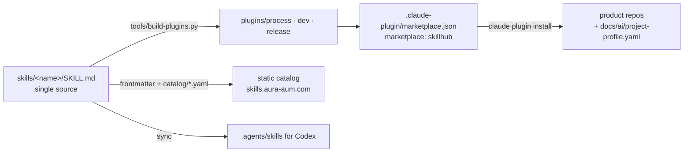

# SkillHub

**Engineering practices as [Agent Skills](https://agentskills.io/specification), shipped as a Claude Code plugin marketplace.**
Built for a product with six repositories and an agent-driven delivery pipeline; published here in a generalized form.

Catalog: **[skills.aura-aum.com](https://skills.aura-aum.com)** (coming soon).

## The case

Six product repos (backend, a second backend for new APIs, mobile, web, admin, a messenger mini-app) are developed
mostly by AI agents: an unattended dev loop implements one small story per PR, a dispatcher session (the coordinating
agent) runs the queues, reviews converge on CI, and a human owner decides only what is risky — production, money,
permissions, destructive migrations.

After a few months the pipeline had **40+ practices** worth writing down, and they lived in the wrong places:

- **3–6 copies of the same rule** across each repo's `CLAUDE.md` / `AGENTS.md`, each worded a little differently
  and drifting apart;
- **knowledge only in the dispatcher's memory** — visible to one session, inherited by no new project;
- forks of the same runbooks (`night-run.md`, `deploy.md`) per repo.

SkillHub turns each practice into **one skill in one place**, and every repo and every agent (Claude Code, Codex)
gets the latest version from `main`.

## Architecture



1. **Agent Skills** — every practice is `skills/<name>/SKILL.md` with optional `references/`, `scripts/`, `evals/`.
   Progressive disclosure: only `name` + `description` load at session start; the body loads on use;
   references load on demand.
2. **Claude Code plugin marketplace** — thin plugins grouped by topic. Plugin copies are *generated* (no symlinks:
   a marketplace clone may not keep them, and a copy is visible in the diff); hand edits to a copy fail CI.
3. **Static catalog** — built from frontmatter and `catalog/*.yaml`: cards, client-side search, ranking.
4. **Project profile** — skills hold no repo-specific values. A repo keeps its branch, merge styles, CI check names,
   release workflow, etc. in `docs/ai/project-profile.yaml`; every skill starts with an *Environment check* that
   reads it and says what to do when a key is missing. See [docs/project-profile.md](docs/project-profile.md).

## Skills

| Plugin | Skill | What it does |
|---|---|---|
| `process` | [story-spec](skills/story-spec/SKILL.md) | Cuts an epic into one-PR stories (≤ 300 diff lines, ≤ 5 code files), assigns keys and decision numbers, writes specs with mandatory header lines and a done command |
| `process` | [retrospective](skills/retrospective/SKILL.md) | Closes every epic with a docs-only retro PR; agent-actionable findings are fixed right away in separate PRs |
| `dev` | [feature-branch-flow](skills/feature-branch-flow/SKILL.md) | Branch from a fresh default branch in a worktree → PR right after the first push → merge in the profile's style on the exact head → delete the branch (GitHub and Gitea) |
| `dev` | [review-by-complexity](skills/review-by-complexity/SKILL.md) | One review round for `normal` stories, up to three for `high`; verdict comes from CI on the exact head; reviewers never merge |
| `dev` | [skill-creator](skills/skill-creator/SKILL.md) | Creates a hub skill only after a duplicate search; proposes editing the cluster leader instead |
| `release` | [merge-and-release](skills/merge-and-release/SKILL.md) | Who merges and when; release PR into `main` as a merge commit (never squash); tag by workflow; immediate `main → dev` sync; deploy only on the owner's word |

## The skill card

Frontmatter follows the Agent Skills spec; hub fields live in `metadata` (string → string):

```yaml
---
name: feature-branch-flow
description: >
  Guides the git flow for a story: ... Use when starting a story, opening or merging a PR, or cleaning up branches.
license: MIT
compatibility: Claude Code >= 2.1, Codex; git, curl, jq
metadata:
  category: development        # → plugin via catalog/categories.yaml
  owner: maintainer
  maturity: trial              # draft | trial | stable | deprecated
  added: "2026-10-22"
  updated: "2026-10-22"        # must equal `git log -1` date of the skill directory
  projects: all
  cluster: git-flow            # similar skills form a cluster ...
  leader: "true"               # ... with one leader
  review-by: "2027-01-22"      # overdue review drops the freshness boost
---
```

Body: ≤ 300 lines / ~4000 tokens, sections in a fixed order — *Environment check* (with a fallback),
*When to use*, *Rules*, *How to apply*, *Verification*, *Exceptions and human stop*, *Project profile*.
History and "why" go to `references/`.

**No versions.** Projects always get the latest skill from `main`; history is `git log` of the skill directory.
That is why every skill must be **self-sufficient**: it carries its own scripts and checks instead of relying on
the text of another skill that may have changed.

**Ranking** (weights in [catalog/ranking.yaml](catalog/ranking.yaml)):
quality (0.40) > invocations in 30 days (0.30) > installs (0.20) > freshness (0.10).
An exact name match is always first; a cluster leader gets ×1.2 and other members ×0.7; `draft` ×0.5.
The catalog shows a **quality band, not a number** — "92 vs 94" invites gaming the score.

**Security flag.** CI computes `ok` or `blocked` per skill: secrets, tokens in `curl`/headers instead of
environment variables, requests to share a token in chat, internal hosts/IPs/SSH targets outside
[catalog/public-hosts.yaml](catalog/public-hosts.yaml), dangerous operations (`rm -rf`, `push --force`,
`image prune -a`, starting compose services without a pinned image) with no human stop nearby. A `blocked` skill is left out
of the plugins.

## CI

[`.github/workflows/ci.yml`](.github/workflows/ci.yml), Python stdlib only:

| Step | Tool |
|---|---|
| Unit tests of the tooling | `python3 -m unittest discover -s tools/tests` |
| Card lint (spec + hub rules) and security lint | `tools/validate.py skills` → `spec_lint.py` + `security_lint.py` |
| Plugin copies match `skills/` | `tools/build-plugins.py --check` |
| Marketplace structure | `tools/check_marketplace.py`, then `claude plugin validate .` |

New skill scaffold: `tools/new-skill.sh <name> --category <id>`. Contribution rules: [CONTRIBUTING.md](CONTRIBUTING.md).

## What we took from Avito's Skills Hub — and what we didn't

The design follows a public talk by Avito's internal developer platform team, *"Skills Hub: how Avito manages
2000+ skills"* (July 2026), scaled down to ~30 skills.

**Taken:** linting against the Agent Skills spec; the self-sufficiency criterion; ranking quality > calls >
installs > freshness with security as a filter; hiding exact scores; no versions — always latest `main`;
security scanning that hides a skill from installation; clusters with a leader and a skill-creator that proposes
contributing to an existing skill; per-project settings file; skill sets (here: plugins).

**Not taken at this scale:**

| Avito mechanism | Why not now | Revisit when |
|---|---|---|
| Postgres index + RAG search (pgvector), MCP search | 30 skills fit on one screen; client-side full-text search is enough | > 100 skills, or search stops finding the right skill first |
| LLM categorization and tag consolidation | 8 categories set by hand, checked by CI | > 100 skills or > 3 authors |
| ACLs inherited from repo access | One owner, no secrets or internal addresses in the hub | External contractors or restricted skills |
| Desktop app / UI authoring for non-engineers | Users are agents and one engineer | A non-engineer starts writing skills |
| Aggregator over many team repos | One hub repo is simpler for one organization | Projects start keeping their own skills |
| Full LLM quality grading on every change | Lint + evals + review are enough; LLM grading once at authoring | > 50 skills or changes outpace review |

## Install

```sh
# Add the marketplace (GitHub shorthand owner/repo)
claude plugin marketplace add maxlord/skillhub
# Install the plugins you need: <plugin>@<marketplace>
claude plugin install process@skillhub
claude plugin install dev@skillhub
claude plugin install release@skillhub
```

For a whole team, declare it in the repo's `.claude/settings.json`:

```json
{
  "extraKnownMarketplaces": {
    "skillhub": { "source": { "source": "github", "repo": "maxlord/skillhub" } }
  },
  "enabledPlugins": { "process@skillhub": true, "dev@skillhub": true, "release@skillhub": true }
}
```

Then add `docs/ai/project-profile.yaml` to the repo ([contract and example](docs/project-profile.md)).
Codex and other Agent Skills clients can use `skills/` directly (e.g. copy into `.agents/skills/`).

## Коротко (RU)

SkillHub — практики разработки как Agent Skills и marketplace плагинов Claude Code. Вырос из конвейера на шесть
продуктовых репо, где код пишут агенты: одно правило жило в 3–6 копиях `CLAUDE.md`, часть знаний — только в памяти
сессии-диспетчера. Теперь каждая практика — один скилл в одном месте; проекты получают последнюю версию из `main`,
свои значения держат в `docs/ai/project-profile.yaml`. В CI — линт карточки по спецификации, security-lint
(секреты, внутренние адреса, опасные операции без стоп-точки), сборка плагинов и проверка манифеста. Идеи
ранжирования, кластеров с лидером и самодостаточности взяты из доклада Авито о Skills Hub, тяжёлую инфраструктуру
(RAG, ACL, LLM-категоризация) на масштабе ~30 скиллов сознательно не строили. Каталог — skills.aura-aum.com (скоро).

## License

[MIT](LICENSE) © 2026 Maksim Kuleshov
